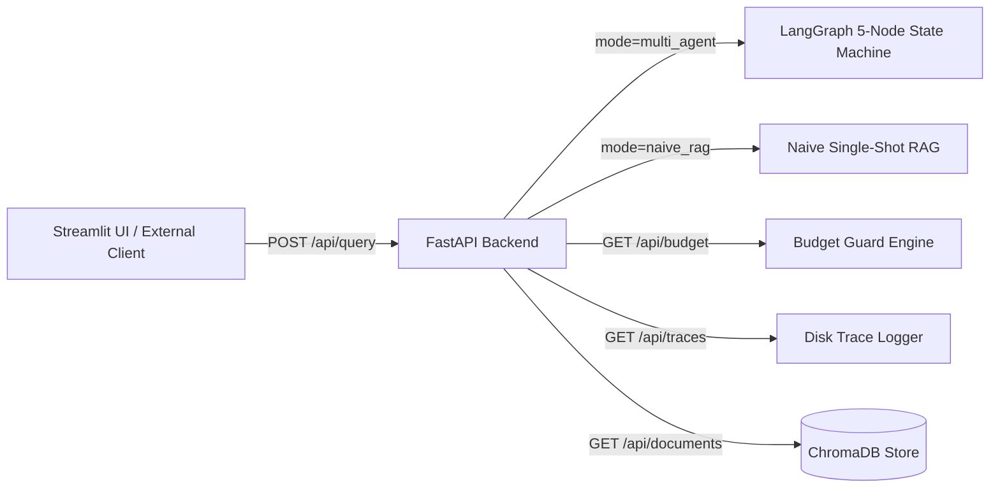

# System Architecture & Multi-Agent State Machine

This document details the technical design of the **Contradiction-Aware Multi-Agent Document Intelligence System**.

---

## 1. High-Level System Architecture

```mermaid
flowchart TD
    subgraph Data Ingestion Layer
        PDF[PDF / Text / OCR Documents] --> Loader[PyMuPDF + Tesseract Fallback]
        Loader --> Chunking[Layout-Aware Chunking Strategy]
        Chunking --> Embed[OpenRouter Embeddings API]
        Embed --> Chroma[(Persistent ChromaDB Store)]
        Chunking --> BM25[(In-Memory BM25 Index)]
    end


    subgraph Complete 5-Node LangGraph State Machine (Phase 5)
        User([User Query]) --> Start[START]
        Start --> OrchestratorNode[Orchestrator Node]
        OrchestratorNode -- needs_retrieval=True --> RetrievalNode[Hybrid Retrieval Node (Dense+BM25 with RRF)]
        OrchestratorNode -- needs_retrieval=False --> SynthesisNode[Synthesis Node]
        Chroma --> RetrievalNode
        BM25 --> RetrievalNode
        RetrievalNode --> SynthesisNode
        SynthesisNode --> CriticNode[Verification Critic Node]
        
        CriticNode -- verification_passed=False (retry < 2) --> RetrievalNode
        CriticNode -- verification_passed=True --> ContradictionNode[Contradiction Analyzer Node]
        ContradictionNode --> EndNode[END / Grounded Answer + Contradiction Alert Box]
    end
```


---

## 2. LangGraph Shared State Design

The core agent network uses a single, strongly-typed shared state across all nodes:

```python
from typing import List, Dict, Any, TypedDict, Optional

class AgentState(TypedDict):
    original_query: str
    sub_queries: List[str]
    retrieved_chunks: List[Dict[str, Any]]
    draft_answer: Optional[str]
    citations: List[Dict[str, Any]]
    verification_passed: bool
    critic_feedback: Optional[str]
    contradictions_found: List[Dict[str, Any]]
    final_answer: Optional[str]
    trace_logs: List[Dict[str, Any]]
```

---

## 3. Core Agent Responsibilities

1. **Orchestrator Node**:
   - Analyzes complex user queries.
   - Decomposes queries into targeted sub-queries (e.g. "What is the payment SLA in v1?" vs "What is the payment SLA in v2?").

2. **Retrieval Node**:
   - Executes **Hybrid Retrieval** (Reciprocal Rank Fusion over Chroma vector similarity + BM25 keyword matching).
   - Applies metadata filters (e.g., filtering by document version or document type).

3. **Synthesis Node**:
   - Consolidates retrieved evidence chunks.
   - Formulates a draft answer with explicit chunk ID citations.

4. **Verification Critic Node**:
   - Inspects the draft answer against raw retrieved chunk text.
   - Verifies whether every statement is strictly backed by retrieved evidence (Grounding check).
   - Triggers re-retrieval loop if evidence is missing or weak.

5. **Contradiction Node**:
   - Compares claims across different documents or versions.
   - Detects explicit conflicts (e.g., notice period changed from 30 days to 90 days).
   - Formulates conflict warnings instead of picking one arbitrary truth.

---

## 4. Evaluation & Benchmarking Architecture (Phase 6)

The system includes a hand-rolled, deterministic evaluation harness that quantitatively proves the advantages of multi-agent state machines over single-shot RAG baselines without heavy external dependencies.

- **Golden Evaluation Suite (`data/eval_set.json`)**: Sized at exactly 6 questions with ground-truth chunk IDs and contradiction labels, strictly respecting the 45-call daily budget limit.
- **Pure-Python Metric Calculations (`src/eval/metrics.py`)**:
  - *Retrieval Recall & Precision*: Set intersection between retrieved chunk IDs and ground-truth chunks.
  - *Faithfulness / Grounding*: Deterministic ratio measuring cited chunks vs. retrieved evidence pool with citation penalty.
  - *Contradiction Detection*: Boolean match testing whether known document conflicts are surfaced with governing precedence.

---

## 5. Decoupled Backend API Layer (FastAPI)

The backend engine is exposed via an asynchronous REST API (`src/api/main.py`):



### Core API Endpoints:
- `GET /health`: Service health, model assignments, indexed chunk counts, and budget status.
- `GET /api/budget`: Live tracking of daily requests used vs. 45-call ceiling and remaining headroom.
- `GET /api/traces`: Chronological JSON trace logs of node transitions, token usage, and latencies.
- `GET /api/documents`: Breakdown of ingested document filenames and chunk distributions.
- `POST /api/query`: Unified query execution endpoint supporting both `multi_agent` and `naive_rag` modes.

---

## 6. Streamlit Observability & Trace Dashboard (Phase 7)

Located in `src/ui/app.py`, the interactive dashboard provides the "demo moment" for technical presentations:

1. **Visual State Machine Trace**: Displays tabbed cards representing each graph node transition:
   - *Orchestrator*: Decomposed sub-queries and intent routing.
   - *Hybrid Retriever*: RRF ranking scores ($k=60$) across dense and lexical results.
   - *Synthesis*: Extracted inline `[chunk_id]` citations.
   - *Verification Critic*: Grounding verification status and self-correction loop attempts.
   - *Contradiction Agent*: Highlighted conflict boxes with governing authority resolutions.
2. **Baseline Toggle**: Side-by-side mode switcher to instantly compare the multi-agent graph with Naive RAG on identical queries.
3. **Live Quota Gauge**: Real-time progress meter tracking OpenRouter daily limits.
4. **1-Click Presets**: Pre-configured query buttons for termination notice periods, payment terms, and breach notification windows.

